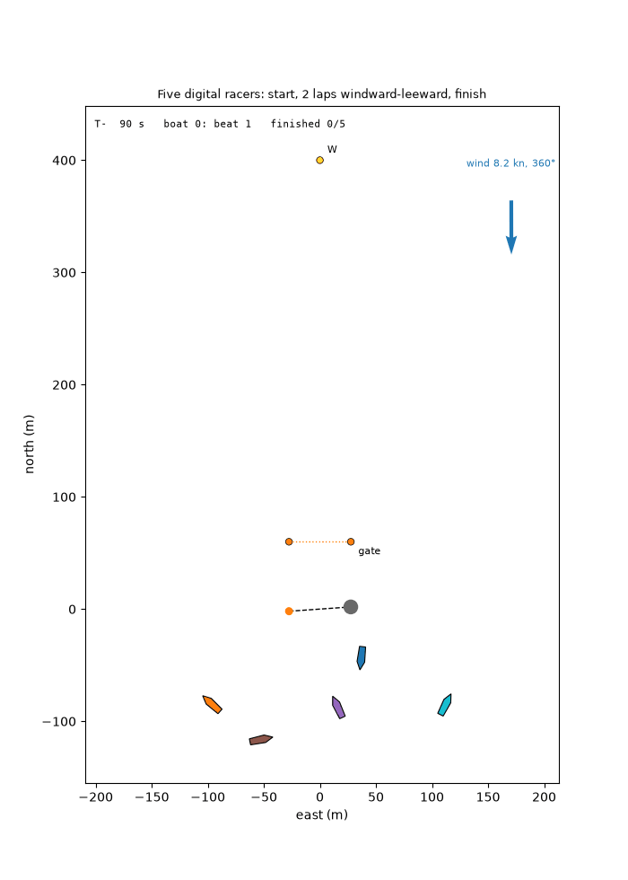
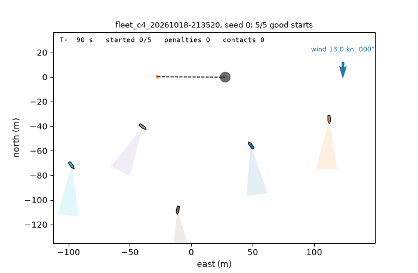
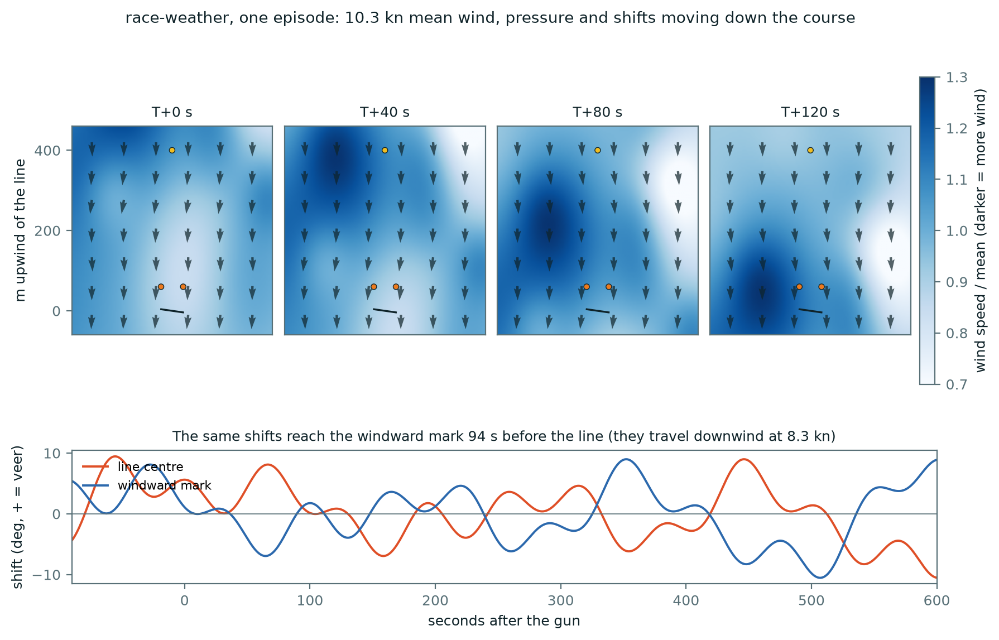
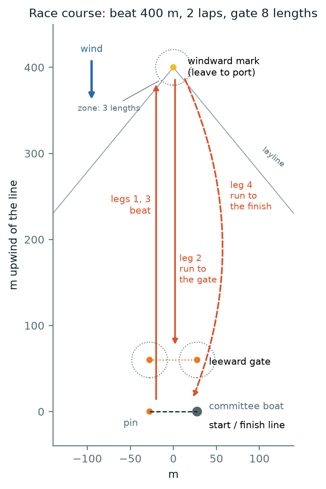
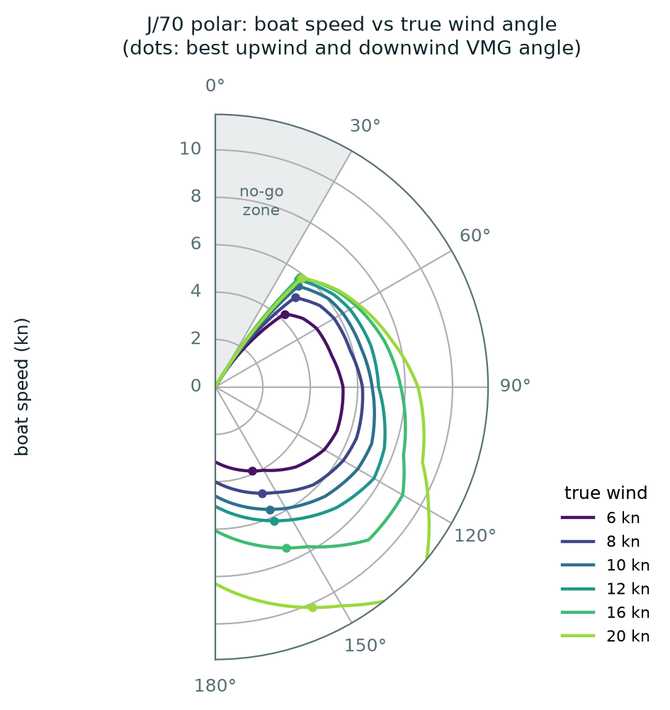

# sail-env

[](https://github.com/tringermate/sail-env/actions/workflows/tests.yml)
[](LICENSE)


**A fast JAX simulator of J/70 keelboat racing for reinforcement learning: the start, the race, a fleet of
boats under the racing rules, and optional weather.**

## TL;DR
I created this simplified sailing race environment for a Multi Agent Reinforcement Learning project ([sail-rl](https://github.com/tringermate/sail-rl)), but I believe it could be used for other RL experiments, too.
The repo was created in cooperation with my one and only Claude Code assistant.
I continuously find bugs in the game due to some small mistakes (like not fully rounding marks etc.), so feel free to let me know if you come across something weird.


## Intro
Sailing races are a good testbed for learning agents. A good start is a split-second timing problem with no
instrument to tell you when you will reach the line. A race lasts up to 1,290 decisions, and only the
finishing place counts. The boat responds with lag, and the wind shifts. In a fleet the boats steal each
other's wind and must obey right-of-way rules. sail-env puts all of this behind a small, pure-functional JAX
API, so thousands of races run in parallel on a laptop CPU or a single GPU.

**[▶ Play it in your browser](https://tringermate.github.io/sail-env/)**: no install needed.

<p align="center">
  
  &nbsp;
  
</p>
<p align="center"><sub><b>Left:</b> five hand-written racers sail two laps of the windward-leeward course. <b>Right:</b> five boats driven by a trained PPO policy approach the line on starboard; each keeps out of its neighbours' wind shadow (shaded cones) and crosses at the gun.</sub></p>

## What is in it

- **Boat:** the J/70 polar from ORC certificate data, speed that builds up with lag and falls off through drag
  and windage, turning limited by speed, tacks and gybes that cost speed, luffing.
- **Racing rules** (a simplified subset of the Racing Rules of Sailing): port/starboard, windward/leeward,
  clear astern, tacking (RRS 10–13), optional changing course (RRS 16), mark-room (RRS 18, simplified),
  touching a mark (RRS 31), penalty turns after getting clear (RRS 44.2), and a reward cost for contact (RRS 14).
- **Wind:** oscillating shifts, line bias, and a wind-shadow cone behind every boat along its apparent wind.
- **Weather (optional):** shifts and pressure (puffs, lulls, a windier side) that travel down the course,
  a current and waves, plus 22 observations of what the boat's instruments and eyes would tell it.
- **Course:** start line, windward mark (left to port), leeward gate, finish; two laps. Roundings count only
  when the boat really goes round the mark.
- **Tasks:** solo and 5-boat starts, solo and fleet races, and 2v2 team racing.
- **Agents:** hand-written "digital sailor" baselines, bundled PPO policies, a reference PPO trainer with
  kickstarting and curricula, and an interface for your own agent.
- **Browser game:** a JavaScript port of the simulator where you can sail against the agents (and your own).
  CI checks every step of it against the Python simulator.

## Installation

```sh
git clone https://github.com/tringermate/sail-env && cd sail-env
pip install -e .            # or: uv sync
```

Python 3.11 or newer and JAX. A CPU is enough; a CUDA GPU is used automatically if present.

## Quick start

```python
import jax
import sail_env as se

env, params = se.make("race")                     # "solo", "fleet", "race-solo", "race", "<preset>-weather"
obs, state = env.reset(jax.random.PRNGKey(0), params)                     # obs: (5, 72)
actions = jax.numpy.zeros(5, dtype=int)                                    # 0 = hold course
obs, state, reward, done, info = env.step(jax.random.PRNGKey(1), state, actions, params)
```

All functions are pure: batch episodes with `jax.vmap`, compile whole rollouts with `jax.lax.scan`.

```sh
python -m sail_env.play --mode race                      # sail it yourself (keyboard; matplotlib window)
python -m sail_env.evaluate --agent digital --mode race-self
python -m sail_env.evaluate --agent digital --mode race-self --weather
python -m sail_env.replay runs/<run>.npz                 # render a saved run as a GIF
```

## Tasks

| Preset | Boats | Horizon | Objective | Observation |
|---|---|---|---|---|
| `solo` | 1 | T−60 → T+10 s (70 decisions) | good start | 60 |
| `fleet` | 5 | T−90 → T+10 s (100) | good start, clear air, height at T+10 | 60 |
| `race-solo` | 1 | start + 2 laps, ≤ T+1200 s (≤ 1290) | finish, fast | 72 |
| `race` | 5 | start + 2 laps, ≤ T+1200 s (≤ 1290) | finishing place | 72 |
| `<preset>-weather` | as above | as above | as above | + 22 |
| `race` with `team_size=2`, `fleet_size=4` | 4 (2v2) | as `race` | team result (lower sum of places; RRS Appendix D) | + 5 teammate flags |

- **Good start:** at the gun the bow is 0–3 m below the line and between its ends; the boat then crosses
  within 3 s, at ≥ 90% of polar speed, on starboard. In the fleet it must also be in clear air at T+10 and owe
  no penalty. There is deliberately no time-to-line instrument.
- **Actions:** 7 discrete, once per second: hold, head up or bear away by 5° or 15°, tack/gybe, luff.
- **Observations:** in the boat's own frame: its own state, the clock, the line ends, the 5 nearest boats
  (relative position, heading, speed, tack, right of way, shadow) and, in the race, the leg, the next marks
  and the penalty state.
- **Weather** parts switch on and off one by one, e.g. `se.make("race-weather", waves=False)`.

The full specification (dynamics equations, rules, observation indices, rewards, presets, limitations) is in
**[docs/ENVIRONMENT.md](docs/ENVIRONMENT.md)**.

<p align="center"></p>
<p align="center"> &nbsp; </p>

## Baselines

Mean ± 95% confidence interval; seed 0, 512 episodes per start row and 128 per race row. Reproduce with
`python tools/run_baselines.py` (raw numbers: [docs/baselines.json](docs/baselines.json)).

- **Random:** uniform random actions.
- **Example (obs only):** the rule-based template in [examples/my_agent.py](examples/my_agent.py).
- **Digital sailor:** a hand-written controller that reads the full state: "time on distance" at the start;
  laylines, VMG angles and proper roundings in the race.
- **RL:** the bundled PPO policies (`sail_env/pretrained/`), greedy actions.

**Starts**

| Task | Agent | Opponents | Good start | Started | OCS | Penalties / boat | Contacts / boat | Place (of 5) |
|---|---|---|---|---|---|---|---|---|
| solo | random | – | 0.2 ± 0.4% | 3.7 ± 1.6% | 18.2 ± 3.3% | – | – | – |
| solo | digital sailor | – | 17.6 ± 3.3% | 61.9 ± 4.2% | 11.1 ± 2.7% | – | – | – |
| solo | RL | – | **86.5 ± 3.0%** | 97.7 ± 1.3% | 0.6 ± 0.7% | – | – | – |
| fleet | digital sailor | 4 × itself | 7.2 ± 1.0% | 30.9 ± 1.8% | 5.7 ± 0.9% | 0.45 ± 0.02 | 1.12 ± 0.04 | – |
| fleet | RL | 4 × itself | **69.2 ± 1.8%** | 90.0 ± 1.2% | 0.0% | 0.22 ± 0.02 | 0.44 ± 0.03 | – |
| fleet | digital sailor | 4 × RL | 5.9 ± 2.0% | 36.9 ± 4.2% | 2.5 ± 1.4% | 0.26 ± 0.04 | 0.43 ± 0.06 | 4.64 ± 0.05 |
| fleet | RL | 4 × digital | **66.2 ± 4.1%** | 84.2 ± 3.2% | 0% | 0.19 ± 0.03 | 0.35 ± 0.06 | **1.63 ± 0.10** |

**Race**

| Task | Agent | Opponents | Started | Finished | Finish time (s) | Place (of 5) | Penalties / boat | Contacts / boat |
|---|---|---|---|---|---|---|---|---|
| race-solo | random | – | 19.5 ± 6.9% | 0% | – | – | 0.33 ± 0.10 | 0.44 ± 0.15 |
| race-solo | example (obs only) | – | 87.5 ± 5.8% | 86.7 ± 5.9% | 827 ± 23 | – | 0.09 ± 0.05 | 0.09 ± 0.05 |
| race-solo | digital sailor | – | 100% | **100%** | **702 ± 15** | – | 0.12 ± 0.06 | 0.12 ± 0.06 |
| race | digital sailor | 4 × itself | 100% | 99.8 ± 0.3% | 714 ± 7 | – | 1.11 ± 0.09 | 2.78 ± 0.16 |
| race | random | 4 × digital | 13.3 ± 5.9% | 0% | – | 5.00 | 0.59 ± 0.14 | 0.83 ± 0.20 |
| race | example (obs only) | 4 × digital | 88.3 ± 5.6% | 87.5 ± 5.8% | 821 ± 22 | 4.98 ± 0.05 | 0.59 ± 0.16 | 1.27 ± 0.37 |

**Learned racers** (not in the table yet): the bundled `rl-racer` and `rl-racer-weather` sail the race alone
21–28 s faster than the digital sailor, in steady wind and in weather. Part of that margin is the digital
sailor's slow gate rounding. For what RL learned in fleet and team racing, and how, see the research log
[sail-rl](https://github.com/tringermate/sail-rl).

Racing with real tactics from the observation alone (splitting, covering, team play) is the open problem.

## Performance

Throughput with `jit` and `vmap` over 1,024 parallel episodes, random actions, compilation excluded
(`python tools/benchmark_speed.py`), on an AMD Ryzen 5 5600H laptop CPU with JAX 0.11.2:

| Preset | Decisions / s | Boat-steps / s |
|---|---|---|
| `solo` | 292,000 | 292,000 |
| `fleet` (5 boats) | 42,500 | 212,000 |
| `race-solo` | 315,000 | 315,000 |
| `race` (5 boats) | 44,500 | 222,000 |

The `-weather` presets cost about 20% more per step. On one RTX 4090, training ran at up to 3.7 million steps
per second with 8,192 races in parallel.

## Bring your own agent

An agent is a factory `make_policy(env, params) -> policy` with `policy(key, obs, state, boat) -> action`, a
pure JAX function (it is jitted and vmapped over boats and episodes). `obs` is what a learned agent should
use; `state` exposes the full simulator state for hand-written controllers. Copy
[examples/my_agent.py](examples/my_agent.py), which documents the observation layout, then:

```sh
python -m sail_env.evaluate --agent mypkg.my_agent:make_policy --mode race-vs
python -m sail_env.evaluate --agent mypkg.my_agent:make_policy --mode fleet-vs --opponents rl --save-replays 5
python -m sail_env.play --mode race --opponents mypkg.my_agent:make_policy        # race against it yourself
```

| Mode | What runs |
|---|---|
| `solo`, `race-solo` | one boat alone |
| `fleet-self`, `race-self` | the agent sails all five boats |
| `fleet-vs`, `race-vs` | the agent sails one boat against four opponents |

Built-in agents: `random`, `hold`, `digital`, `rl`, `rl-solo` (start policies), `rl-racer`, `rl-racer-weather`
(full-race policies), or the path of a training run. Every session can be saved as a replay (`.npz` plus a
`.json` sidecar) and adds a line to `runs/leaderboard.csv`, so people and agents can be compared.

### In the browser

[web/](web/) holds the browser game: the simulator, the hand-written agents and the RL network in JavaScript,
built into one self-contained `web/index.html`. **[Play it online](https://tringermate.github.io/sail-env/)**,
or open the file locally. To race your
own network there, export it and pick **Opponents → Your agent…** (the file stays on your device):

```sh
python -m sail_env.agents.export runs/train/<run> -o my_agent.json      # or a bundled name, e.g. racer
```

The browser version has no weather, so agents with weather inputs play in Python only.

## Training

[sail_env/train/ppo.py](sail_env/train/ppo.py) is a reference PPO in the PureJaxRL style, in one heavily
commented file: the whole rollout and update compile into one program, and several seeds train in parallel.

```sh
python -m sail_env.train.run configs/solo_staged.yaml   # solo start, staged success criteria
python -m sail_env.train.run configs/fleet.yaml         # fleet start, warm-started from the solo policy
```

- **Curricula:** staged success criteria, and samplers over starting situations and rule levels (uniform,
  SFL, success-guided) in `sail_env/train/curriculum/`.
- **Kickstarting:** `teacher: digital` (any agent) with `ppo.kick_coef` / `ppo.kick_until` adds an imitation
  loss towards the teacher's actions in the states the policy visits, fading to 0, after which plain PPO can
  improve past the teacher.
- **Self-play and opponent pools:** one shared network sails every learning boat; a share of races can put
  boats in the hands of frozen snapshots or fixed agents (`opponents:`, `ppo.opp_frac`).
- Logging to Weights & Biases is optional.

The configs behind the racers and the fleet and team runs are in
[sail-rl](https://github.com/tringermate/sail-rl).

## Validation

- **208 tests** (`pytest`) cover the physics, the weather, the start and fleet rules, the race (roundings,
  gate, finish, mark-room, ranking, penalties), team racing, the agent interface, replays and training.
  They run in CI on Python 3.11 and 3.12.
- **Browser parity:** CI replays six reference episodes recorded by the Python simulator in the JavaScript
  port, including two full 5-boat races. After every step positions must agree within 1 cm, discrete states
  must be identical, and the agents must choose the same actions. The largest measured error is 0.1 mm.

## Limitations

- **Simplified rules:** a subset of the RRS; proper course, luffing rights after an overlap from astern and
  room to tack at a mark are not modelled.
- **Simplified wind:** a kinematic weather pattern (puffs keep their shape), a uniform current, waves that
  only change speed, and a geometric wind-shadow cone.
- **Physics constants:** the polar comes from the ORC velocity prediction program, not from measurements;
  the deceleration constants are estimates.
- **Coarse controls:** 5° and 15° heading changes, once per second.
- **Little difference between the sides of the course:** even with weather, the persistent features that
  favour one side are small, which may be why learned fleets sail in a tight pack instead of splitting.
- **Reward defaults come from the start:** `contact_cost` = 2 suits starts but outweighs the whole place
  reward in a race; fleet-racing configs should lower it (e.g. 0.25).
- **Team racing** changes the scoring and the observation only, not the rules.

More in [docs/ENVIRONMENT.md §9](docs/ENVIRONMENT.md#9-not-modelled-limitations).

## Roadmap

1. Measure how much the side of the course is worth (the digital sailor forced left vs right on the same races).
2. Make the sides differ more, and less predictably (behind flags): larger persistent pressure differences and
   shifts, a current that varies across the course, and a favoured side the boats can only partly see in
   advance, so that going the other way is a gamble with a real payoff.
3. Team-racing rules (proper course, luffing rights) and 3v3.
4. Bundle a learned fleet racer and add it to the baselines.

## Repository layout

```text
sail_env/
  config.py, presets.py        EnvParams (every tunable number, SI units) and the named presets
  polar.py, wind.py, weather.py, physics.py, geometry.py, rules.py
  start_env.py                 solo start          fleet_env.py, fleet_rules.py   fleet start and racing rules
  race_env.py                  the full race: course, roundings, mark-room, finish, team racing
  agents/                      agent interface, digital sailor and racer, bundled-policy loader, export
  play.py, evaluate.py, replay.py, runs.py, render.py        tools
  train/                       reference PPO, trainer, curricula, logging
  data/, pretrained/           J/70 polar (ORC), bundled policies
web/                           browser game (sim.js: JavaScript port; check.js: parity test)
docs/                          ENVIRONMENT.md, figures, baselines.json
configs/  examples/  tools/  tests/
```

## Citation

If you use sail-env, please cite it (metadata in [CITATION.cff](CITATION.cff)):

```bibtex
@software{sail_env,
  author  = {Tringer, Máté},
  title   = {{sail-env}: A {JAX} Simulator of {J/70} Fleet Racing for Reinforcement Learning},
  year    = {2026},
  version = {0.2.0},
  url     = {https://github.com/tringermate/sail-env},
  license = {MIT}
}
```

## License and acknowledgements

MIT ([LICENSE](LICENSE)). The J/70 polar is derived from ORC certificate data via
[jieter/orc-data](https://github.com/jieter/orc-data) (MIT). The functional API follows
[gymnax](https://github.com/RobertTLange/gymnax), and the reference PPO follows
[PureJaxRL](https://github.com/luchris429/purejaxrl). The rules follow the
[Racing Rules of Sailing 2025–2028](https://www.racingrulesofsailing.org/) in simplified form.
